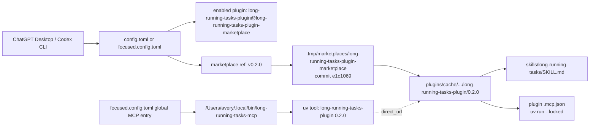
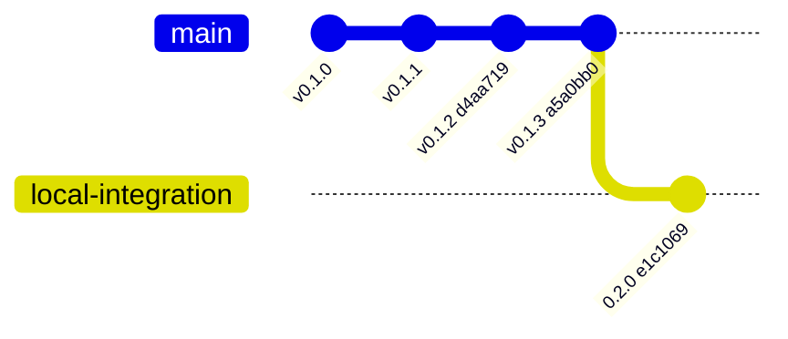
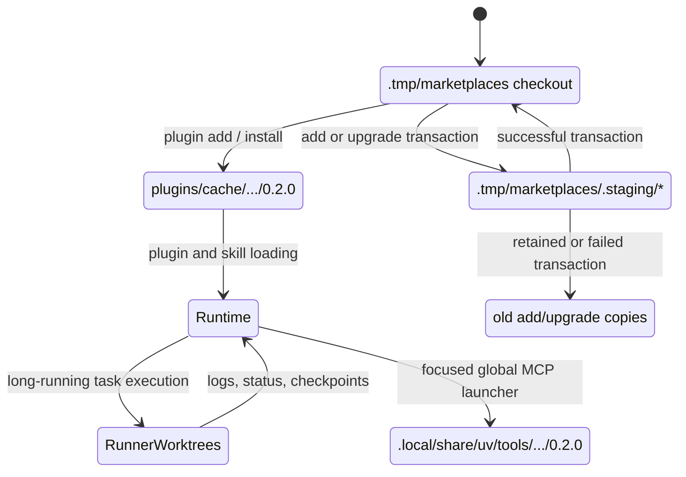

# Long-Running Tasks Plugin Consumption Audit

Audit date: 2026-09-30
Repository: `/Users/avery/build/low-level-tools/long-running-tasks-plugin`
Marketplace: `long-running-tasks-plugin-marketplace`

## Executive summary

At the start of this audit, the enabled `@Long-Running Tasks` connector was not
consuming the current repository build. It was consuming release `0.1.2` from
Git commit `d4aa719` (`v0.1.2`). The installed skill was therefore the older
skill at:

`/Users/avery/.codex/plugins/cache/long-running-tasks-plugin-marketplace/long-running-tasks-plugin/0.1.2/skills/long-running-tasks/SKILL.md`

The current repository plugin metadata was `0.2.0` at committed
`HEAD=e1c1069`, with additional uncommitted observability work in the working
tree. The old cache matched tag `v0.1.2` exactly across all 23 packaged tracked
files. The difference was explained by the configured marketplace ref, not by
a hidden canonical plugin directory.

The Codex CLI and Desktop-facing configuration paths were aligned with each
other at the old ref: both visible config files pinned `v0.1.2`. The separate
global MCP launcher also ran package `0.1.2`, and its `direct_url.json` pointed
back to the same marketplace cache.

Alignment is now complete. The remote `v0.2.0` tag points to `e1c1069`, both
configuration files pin `v0.2.0`, the active marketplace checkout resolves to
that revision, the installed cache is `0.2.0`, and the standalone `uv` MCP
environment imports `0.2.0` from that same cache path.

## Initial pre-alignment evidence

| Surface | Observed version / revision | Evidence | Status |
| --- | --- | --- | --- |
| Enabled plugin connector | `0.1.2`, ref `v0.1.2` | `codex plugin list --marketplace long-running-tasks-plugin-marketplace --json` | Active |
| Consumed skill | SHA-256 `036131b8bed44c8557ac1225253d453c1c7a4a5e14fa059cdf01be78519b8351` | Installed cache `SKILL.md` | Active |
| Repository skill | SHA-256 `4fdafb0603eb9ffe0c274011e263c62c92ded8afffe087f6890f4ec737f816bd` | Repository `SKILL.md` | Current local source |
| Active marketplace checkout | `d4aa719`, `v0.1.2` | `.codex-marketplace-install.json` | Active source snapshot |
| Installed plugin cache | `0.1.2` | `plugins/cache/.../0.1.2` | Active plugin payload |
| Global MCP package | `0.1.2` | `uv tool list`; module import; `direct_url.json` | Active in focused profile |
| Remote `main` | `a5a0bb0`, `v0.1.3` | `git ls-remote origin` | Remote latest |
| Local repository `HEAD` | `e1c1069`, package `0.2.0` | plugin manifest, `pyproject.toml`, `__version__`, `uv.lock` | Current local candidate |

The active cache was compared with `v0.1.2` using content hashes: 23 tracked
package files were checked and there were zero mismatches. The current local
plugin differs in its manifest, skill, Python package, README, lockfile, and
workflow-related files.

The `v0.1.3` remote tag is not the current local integration build. It changes
the runner and tests, but its plugin manifest and marketplace source ref still
advertise `0.1.2`. The local repository has advanced to `0.2.0` and its
marketplace manifest already points at `v0.2.0`, but that tag was not present on
the remote at audit time.

## Post-alignment verification

The final live checks report:

| Check | Result |
| --- | --- |
| Codex plugin listing | `0.2.0`, enabled, source ref `v0.2.0` |
| Marketplace checkout | `v0.2.0`, revision `e1c1069e15293f5905e00420defd7373cd9514ca` |
| Installed cache | `/Users/avery/.codex/plugins/cache/long-running-tasks-plugin-marketplace/long-running-tasks-plugin/0.2.0` |
| Skill hash | Repository and cache both `4fdafb0603eb9ffe0c274011e263c62c92ded8afffe087f6890f4ec737f816bd` |
| Global MCP package | `0.2.0`, direct URL points to the `0.2.0` cache |
| Remote release tag | `origin/v0.2.0` exists and points to the published candidate |
| Repository integration validator | Passed |
| Repository test suite | `93 passed` |
| Shipped-cache test suite | `83 passed, 1 failed` because the packaged integration test expects the repository-root `.agents/plugins/marketplace.json`, which is not part of the installed plugin cache |
| Current Desktop process | Not forcibly restarted during this audit; quit/relaunch Codex Desktop to reload already-open plugin context |

The shipped-cache failure is a packaging/test-harness limitation rather than a
runtime version mismatch. It is retained here as follow-up evidence instead of
changing the published `0.2.0` candidate or the user's unrelated dirty work.

## Runtime resolution

The dashed edge is a recorded installation provenance link, not a runtime
network call. The plugin-provided MCP configuration and the focused profile's
global MCP entry are two ways of launching the same old package payload.

## Version and release history

Interpretation: the connector remains pinned to the older release even though
the local repository contains a later integration build. The uncommitted
observability files are newer working-tree material and are intentionally not
represented as a release in this graph.

## Marketplace and runtime lifecycle

## Filesystem inventory

### Active configuration and source selection

| Path | Purpose | Observed use |
| --- | --- | --- |
| `/Users/avery/.codex/config.toml` | Normal Codex configuration; enables the plugin and pins marketplace ref `v0.2.0`. | Active configuration source. |
| `/Users/avery/.codex/focused.config.toml` | Focused configuration; repeats marketplace ref `v0.2.0` and declares the global `long_running_tasks` MCP server. | Active when the focused profile is selected. |
| `/Users/avery/.codex/.tmp/marketplaces/long-running-tasks-plugin-marketplace` | Materialized Git marketplace checkout. | Active checkout selected by Codex; at `e1c1069` / `v0.2.0`. |
| `/Users/avery/.codex/.tmp/marketplaces/long-running-tasks-plugin-marketplace/.codex-marketplace-install.json` | Records Git source, ref, and resolved revision. | Active provenance record. |

### Installed plugin and MCP payloads

| Path | Purpose | Observed use |
| --- | --- | --- |
| `/Users/avery/.codex/plugins/cache/long-running-tasks-plugin-marketplace/long-running-tasks-plugin/0.2.0` | Versioned installed plugin payload used by the connector. | Active; exact `v0.2.0` content. |
| `/Users/avery/.codex/plugins/.marketplace-plugin-source-staging/marketplace-plugin-source-zFKGg4` | Clean marketplace source staging clone at `v0.1.2`. | Install-time source staging; not the runtime cache. |
| `/Users/avery/.codex/plugins/.marketplace-plugin-source-staging/marketplace-plugin-source-RLAPF4` | Another source staging clone at `v0.1.3`, with deleted files in its Git status. | Retained/dirty staging artifact; not selected by configuration. |
| `/Users/avery/.local/bin/long-running-tasks-mcp` | Symlinked MCP executable. | Active in `focused.config.toml`. |
| `/Users/avery/.local/share/uv/tools/long-running-tasks-plugin` | Isolated `uv` tool environment for the global MCP executable. | Active package `0.2.0`; direct URL points to the installed cache. |
| `/Users/avery/.codex/plugins/cache/long-running-tasks-plugin-local` | Local-marketplace plugin cache namespace. | Empty and not referenced by the observed configuration. |

### Temporary marketplace areas

| Path | Purpose | Observed use |
| --- | --- | --- |
| `/Users/avery/.codex/.tmp/marketplaces` | Working checkouts for configured Git marketplaces. | Contains the active long-running marketplace checkout and unrelated marketplace sources. |
| `/Users/avery/.codex/.tmp/marketplaces/.staging` | Transaction scratch area for marketplace add/upgrade operations. | Contains retained historical copies. |
| `/Users/avery/.codex/.tmp/marketplaces/.staging/marketplace-add-Gxf1wA` | Add transaction at `v0.1.1`. | Historical, not selected. |
| `/Users/avery/.codex/.tmp/marketplaces/.staging/marketplace-add-lS2PkI` | Duplicate add transaction at `v0.1.1`. | Historical, not selected. |
| `/Users/avery/.codex/.tmp/marketplaces/.staging/marketplace-upgrade-AayoHC` | Upgrade transaction with checkout `v0.1.3`; embedded plugin metadata still says `0.1.2`. | Retained transaction artifact, not selected. |
| `/Users/avery/.codex/.tmp/marketplaces/.staging/marketplace-upgrade-FLNcLS` | Duplicate upgrade transaction with the same characteristics. | Retained transaction artifact, not selected. |
| `/Users/avery/.codex/.tmp/plugins` | Generic local checkout for the configured `openai-curated` marketplace. | Used for unrelated curated plugins; no long-running plugin copy found. |
| `/Users/avery/.codex/.tmp/bundled-marketplaces/openai-bundled` | Bundled OpenAI marketplace source. | Used for bundled plugins; unrelated to this plugin. |

### Long-running task runtime data

`/Users/avery/.codex/long-running-tasks` is runtime state, not plugin source.
Its `runs`, `logs`, `snapshots`, `locks`, `worktrees`, `workers`, `core`,
`docs`, and `telemetry` directories hold execution records and managed
worktrees. Existing managed worktrees include both `0.1.2` and `0.2.0` plugin
copies because they were created by different historical runs. They must not be
treated as the marketplace source of truth or deleted as cache cleanup.

Other `.codex/.tmp/git-*` directories are generic transient Git work areas and
were not identified as long-running plugin sources.

## Alignment procedure and result

The clean committed `HEAD=e1c1069` was used as the `0.2.0` release candidate.
The existing uncommitted observability changes remain preserved and were not
included in that release.

1. Published the clean `v0.2.0` tag to the configured Git remote.
2. Updated both Codex config files from `v0.1.2` to `v0.2.0`.
3. Refreshed the configured Git marketplace and reinstalled the plugin cache.
4. Reinstalled the standalone `uv` MCP tool from the resulting `0.2.0` cache.
5. Verified the new process-visible CLI state and package provenance.
6. Kept historical staging directories and runner worktrees intact. A Desktop
   quit/relaunch remains the safe manual final step because forcing it would
   terminate this active audit session.

## Acceptance checks

After alignment, the following checks were run:

- [x] `codex plugin list --json` reports enabled version `0.2.0` and ref `v0.2.0`.
- [x] The consumed cached skill and repository skill have identical SHA-256 hashes.
- [x] The marketplace checkout revision, plugin cache, and standalone MCP package
  all resolve to `v0.2.0`.
- [x] `plugins/long-running-tasks-plugin/scripts/validate_integration.py` passes.
- [x] No active task lock, log, snapshot, or managed worktree was deleted.
- [x] Mermaid source imports and static-lints successfully; native SVG/HTML
  rendering was not available because no local `mmdc` renderer is installed.
