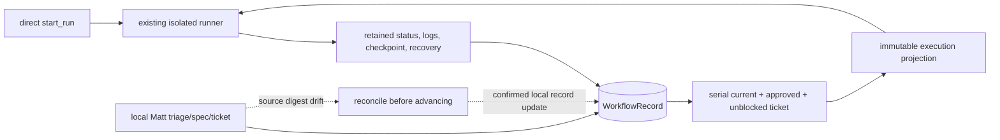

# Long-Running Tasks

Long-Running Tasks turns an explicit `TASK.md` and strict `PLAN.md` into
isolated, verifiable Codex slices. Each successful slice updates the plan,
records versioned state, creates an implementation checkpoint, and adds an
annotated Git tag.

The plugin uses a Python stdio MCP server and a locked `uv` environment. A run
gets an external retained worktree and a branch named
`codex/long-running/<run_id>`; the target repository's base branch is never
modified. Runtime records, continuation summaries, and detailed logs stay
outside the target repository.

The workflow integration is documented in [Canonical workflow integration](docs/workflow.md).
It preserves the direct runner and adds a local, serial-first coordination path
for triage, specs, tickets, provenance, immutable execution projections, and
reconciliation.

## Choose an execution path

Use direct `start_run` when the user has an explicit `TASK.md` / `PLAN.md` task
and does not need source-artifact scheduling. Use the canonical workflow path
when triage, spec, ticket, and run nodes should be linked in a local
`WorkflowRecord`.

Both paths use the same isolated runner and recovery controls. The canonical
record and projections are external local runtime data; Matt source files and
the base checkout remain read-only to orchestration.

## Prepare a repository

The target must be a clean Git repository. Add a task definition with a goal,
observable acceptance criteria, and exactly one shell verification command:

~~~markdown
# Task

## Goal

Describe the desired outcome.

## Acceptance criteria

- State an observable acceptance condition.

## Verification

    python -m pytest
~~~

Add one idempotent slice per strict plan item:

~~~markdown
- [ ] T001: Implement the first bounded slice
- [ ] T002: Add verification coverage
~~~

The runner owns `PLAN.md`, `.codex-loop/state.json`, verification, commits, and
tags. Codex must not edit the task or plan files, commit, tag, merge, push, or
publish.

## Codex skill example

Ask Codex to start a durable run for an explicit repository:

~~~text
$long-running-tasks-plugin:long-running-tasks
Start a durable run for /absolute/path/to/repo with approval_mode=policy.
Continue verified slices automatically, pause for failures, risk, ambiguity,
or merge/publish intent, and never push or merge automatically.
~~~

The skill teaches the runner's state machine, worktree policy, context-pressure
continuation, and recovery behavior. Use the returned `run_id` to monitor the
same run rather than starting a second run for the repository.

## MCP examples

Start an asynchronous run. The tool returns immediately with a stable `run_id`:

~~~json
{
  "repo_path": "/absolute/path/to/repo",
  "approval_mode": "policy",
  "max_iterations": 10
}
~~~

Then use the read-only tools with bounded pages:

~~~json
{
  "run_id": "ab12cd34ef56"
}
~~~

~~~json
{
  "run_id": "ab12cd34ef56",
  "limit": 50,
  "cursor": "line:50"
}
~~~

Useful lifecycle calls are:

- `get_run_status(run_id)` for the current state, worktree, branch, slice, and checkpoint.
- `get_run_logs(run_id, limit, cursor)` for bounded structured progress and failure details.
- `list_runs(repo_path, limit, cursor)` to find an existing run.
- `resume_run(run_id, approval_mode?)` after an approval pause or recoverable failure.
- `recover_run(run_id, confirm=true)` after `needs_recovery` and a review of the retained worktree.
- `cancel_run(run_id, confirm=true)` to stop safely while retaining the worktree for inspection.

Mutating tools require explicit confirmation where applicable. Cancellation may
briefly return `cancelling` while the Codex and verification process groups
exit; the repository lock remains held until the worker is gone.

### Canonical workflow calls

The workflow facade is intentionally small and serial-first:

- `create_workflow` validates and idempotently registers a local record;
- `schedule_workflow` returns at most one current, approved, unblocked ticket;
- `start_workflow` binds that ticket to the existing isolated runner;
- `get_workflow_projection` reads the immutable input snapshot captured for a run;
- `reconcile_workflow` audits source digests and persists stale transitions only
  with confirmation.

`parallel` scheduling fails explicitly. When reconciliation finds a changed,
missing, or unverifiable source artifact, it can mark the record stale; the
scheduler then stops automatic advancement until reconciliation is reviewed.
Failed, interrupted, paused, and `needs_recovery` runs retain their external
worktree, logs, projection, and runtime record for inspection and recovery.

The CLI exposes the same operations under `workflow`, for example:

~~~sh
uv run --locked long-running-tasks workflow create workflow.json
uv run --locked long-running-tasks workflow schedule workflow-001
uv run --locked long-running-tasks workflow start /absolute/path/to/repo \
  --workflow-id workflow-001 --detach
uv run --locked long-running-tasks workflow projection ab12cd34ef56
uv run --locked long-running-tasks workflow reconcile workflow-001 --confirm
~~~

See [workflow.md](docs/workflow.md) for the record shape, ownership table,
Mermaid lifecycle, and recovery boundaries.

## Install the pinned Matt-tools bundle

`matt-tools-three` contains exactly `skills/engineering/to-spec`,
`skills/engineering/to-tickets`, and `skills/engineering/triage` from the
pinned `git-bbq-matt-skills` source commit
`64fb7a440ff4a5e0b3d82680b2d73c2b93e1f2fa`. The setup companion is recorded as
a reference only. The default `bundled` mode is offline-capable, checksum
verified, idempotent, and does not run repository setup:

~~~python
from pathlib import Path
from long_running_tasks import install_matt_tools

result = install_matt_tools(Path(".codex/skills/matt-tools"))
print(result.source_commit, result.record_path)
~~~

Use `mode="sibling-checkout"` with an explicit pinned local checkout or
`mode="explicit-fetch"` when network access is intentionally allowed. Every
installation record includes the source repository, source commit, selected
paths, content digests, and its own digest. Existing conflicting files are
reported rather than overwritten.

## CLI examples

The CLI uses the same core library and external runtime store:

~~~sh
cd /path/to/long-running-tasks-plugin/plugins/long-running-tasks-plugin

# Start a durable worker and return immediately.
uv run --locked long-running-tasks start /absolute/path/to/repo \
  --approval-mode policy --detach

# Inspect the run and page its logs.
uv run --locked long-running-tasks status ab12cd34ef56
uv run --locked long-running-tasks logs ab12cd34ef56 --limit 50

# Resume, recover, or cancel after reviewing status.
uv run --locked long-running-tasks resume ab12cd34ef56
uv run --locked long-running-tasks recover ab12cd34ef56 --confirm
uv run --locked long-running-tasks cancel ab12cd34ef56 --confirm
~~~

Set `LONG_RUNNING_TASKS_DATA_DIR` to place external logs, snapshots, journals,
and worker metadata in a chosen cache directory:

~~~sh
export LONG_RUNNING_TASKS_DATA_DIR="$HOME/.cache/long-running-tasks"
~~~

## Approval modes and unattended operation

`policy` is the safe default. Routine verified changes continue automatically;
the runner pauses for destructive changes, failed verification, ambiguous
requirements, Codex approval events, risky command intent, or merge/publish
actions.

`unattended` is the explicit opt-in for suppressing routine prompts:

~~~json
{
  "repo_path": "/absolute/path/to/repo",
  "approval_mode": "unattended"
}
~~~

It still stops on failure, risk, ambiguity, approval signals, or merge/publish
intent. It never pushes, merges, or publishes automatically. The launcher uses
`--approve-for-me` without an explicit `--sandbox` flag; current Codex CLI
rejects those two flags together. On native session resume, the plugin uses
the equivalent `workspace-write` plus `approvals_reviewer=auto_review`
configuration because `codex exec resume` does not accept
`--approve-for-me`.

`never` is a separate, advanced unattended mode:

~~~json
{
  "repo_path": "/absolute/path/to/repo",
  "approval_mode": "never"
}
~~~

It uses `--dangerously-bypass-approvals-and-sandbox` and therefore disables
Codex's approval and sandbox controls. Never combine that flag with
`--approve-for-me` or `--sandbox`. The runner's own risk gates and its
no-push/no-merge/no-publish policy still apply. The raw `on-request` and
`auto_review` modes remain available for compatibility.

## Checkpoints, continuation, and recovery

Before each slice is checkpointed, the runner runs the task's verification
command and checks for cancellation. A successful slice has exactly one checked
plan item, a committed `.codex-loop/state.json`, an implementation commit, and
an annotated deterministic tag such as `codex-run/ab12cd34ef56/T001`. Only the
verified slice, runner-owned `PLAN.md`, and runner-owned state are staged;
verification artifacts and detailed logs are not staged.

When context pressure reaches the configured threshold, the runner persists
state, writes an external continuation summary, and resumes the same native
Codex session with `codex exec resume`. Three failed native resume attempts
become `needs_recovery`; the runner never silently switches to an unrelated
session.

If a worker stops at a commit or tag boundary, `recover_run` reconciles the
recorded journal and exact change manifest without overwriting a conflicting
tag. Review the retained worktree before confirming recovery. A failed
verification leaves changes available for inspection and creates no checkpoint.

## Development and release checks

~~~sh
uv run --locked pytest
uv lock --check
PYTHONPATH=src python3 scripts/validate_integration.py
uv run --with pyyaml python3 /Users/avery/.codex/skills/.system/plugin-creator/scripts/validate_plugin.py .
~~~

The local repository marketplace is at
`../../.agents/plugins/marketplace.json`. Release metadata is synchronized at
`0.2.0` across the plugin manifest, Python package, import version, lockfile,
changelog, and marketplace pin `v0.2.0`. Tagging, publishing, and marketplace
availability remain release-owner actions; the runner never performs them.

## Attribution and license

Created and maintained by Avery Freeman. Source repository: [Codex-long-running-task-plugin](https://github.com/averyfreeman/Codex-long-running-task-plugin).

Released under the [MIT License](LICENSE), copyright © 2026 Avery Freeman.
