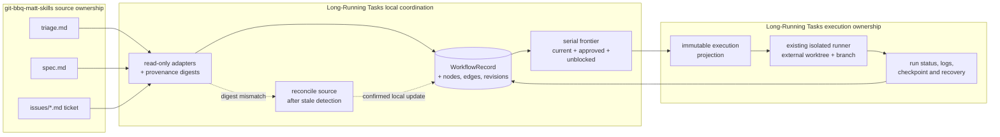

# Canonical workflow integration

Long-Running Tasks has two compatible entry points:

- `start_run` executes the existing `TASK.md` / `PLAN.md` contract directly.
- The canonical workflow path coordinates local Matt triage, spec, and ticket
  artifacts before handing one selected ticket to that same isolated runner.

The workflow path is local-only and serial-first. It complements the separate
`git-bbq-matt-skills` source repository; it does not become a second source
repository and it does not run repository setup implicitly.

## Ownership boundary

| Boundary | Owns | Does not own |
| --- | --- | --- |
| `git-bbq-matt-skills` | The source skill content and the local Markdown conventions for triage, specs, and tickets. | Canonical workflow state, runner status, or execution worktrees. |
| Matt artifact adapters | Read-only discovery, source-label normalization, blocker edges, and SHA-256 provenance capture. | Source-file edits or source-status changes. |
| Local workflow store | Versioned `WorkflowRecord` JSON, node lifecycle events, typed edges, revisions, and reconciliation results. | Git branches, task execution, or remote publication. |
| Scheduler/controller | Serial frontier selection, stale fail-closed behavior, and explicit reconciliation. | Parallel scheduling or automatic source mutation. |
| Long-Running Tasks runner | `TASK.md` / `PLAN.md` execution, external worktrees, branches, verification, checkpoints, logs, and recovery. | Writes to the base checkout or silent changes to an immutable projection. |

The canonical record and run store default to
`~/.codex/long-running-tasks` (or `LONG_RUNNING_TASKS_DATA_DIR`). The source
checkout and base checkout remain outside that store and are never used as the
workflow database.

## Lifecycle



1. Read local triage, spec, and ticket Markdown through the adapters. Each
   source node keeps its artifact reference and content digest; blocker
   references become directed `blocks` edges.
2. Validate and create the local record with `create_workflow`. The record can
   contain `triage`, `spec`, `ticket`, and later `run` nodes, plus provenance
   and lifecycle history.
3. Call `schedule_workflow`. It returns at most one ticket. The ticket must be
   current, approved, in a runnable status, and free of unresolved blockers.
   `parallel` is rejected explicitly; it is not silently treated as serial.
4. Call `start_workflow` with the record or its ID. The runner captures the
   selected ticket and source digests in an immutable execution projection
   under the external runtime store, then uses the same worktree and branch
   isolation as `start_run`.
5. Inspect the run with the normal status/log/recovery operations and inspect
   the exact captured input with `get_workflow_projection` or the CLI
   `workflow projection` command. Runner status is projected onto the run node
   without rewriting the source artifacts or the projection.
6. Run `reconcile_workflow` to check source digests. If a digest changes, a
   source is missing, or it cannot be verified, review the dry-run and use
   explicit confirmation to persist stale transitions. The scheduler then
   stops automatic advancement until a later adapter/source update makes the
   record current again.

## Record shape

The serialized record has `schema_version: 1`, a local `repo_path`, a
`workflow_id`, `automation_mode: "serial"`, lifecycle status and revision,
typed `nodes`, directed `edges`, and append-only `events`.

Source nodes use these kinds:

- `triage` — the approval and scope decision;
- `spec` — the current implementation contract;
- `ticket` — a schedulable unit of work;
- `run` — the retained execution and its projected status.

Every node has `provenance.digest` and `provenance.source_ref`. The usual
relationships are `produces` (triage/spec to downstream source artifacts),
`blocks` (blocker to blocked ticket), and `executes` (ticket to run). Records
are immutable at the Python API boundary: transitions return a new revision,
and the store writes JSON atomically with an expected-revision check.

## Pinned Matt-tools bundle

`matt-tools-three` contains exactly these source paths from the pinned
`git-bbq-matt-skills` commit:

```text
repository: https://github.com/averyfreeman/git-bbq-matt-skills.git
commit:    64fb7a440ff4a5e0b3d82680b2d73c2b93e1f2fa
```

```text
skills/engineering/to-spec
skills/engineering/to-tickets
skills/engineering/triage
```

`skills/engineering/setup-matt-pocock-skills` is recorded as a companion
reference only. The default `bundled` installer reads vendored package files,
verifies their checksums, writes an installation record, and works without a
network. Repeating it is idempotent; changed managed files are reported as a
conflict rather than overwritten. `explicit-fetch` and `sibling-checkout` are
opt-in source modes and must prove the pinned commit before copying anything.

The public Python entry point is:

```python
from pathlib import Path
from long_running_tasks import install_matt_tools

result = install_matt_tools(Path(".codex/skills/matt-tools"))
```

The result records the bundle ID, source repository, source commit, selected
paths, file digests, and installation-record digest. No repository setup is
invoked by this installer.

## Failure and recovery

Failed, interrupted, paused, cancelled, and `needs_recovery` runs retain their
run JSON, logs, task snapshot, projection (when workflow-bound), and external
worktree for inspection. Review the retained state before using:

- `resume_run` / `resume` for a paused or failed run that is safe to retry;
- `recover_run --confirm` / `recover --confirm` after a worker or process
  boundary requires checkpoint reconciliation;
- `get_workflow_projection` / `workflow projection` to prove the retry still
  has the original ticket and source digests;
- `reconcile_workflow --confirm` only after reviewing source drift.

Retention preview and pruning apply only to explicitly confirmed terminal
runtime artifacts. Recoverable failure and interruption records remain
protected. Neither workflow reconciliation nor recovery merges, pushes, or
publishes changes.
